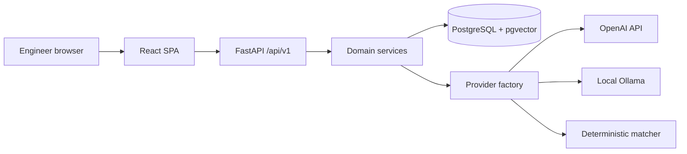

# Architecture

VAVE Intelligence is a single-page React application and a FastAPI service. PostgreSQL, with pgvector, is the system of record. The browser never calls an inference provider.

## Layers

- Presentation: React routes under `frontend/src/features`. Server state uses TanStack Query. The UI does not calculate official savings or rejection status.
- API: thin handlers in `backend/app/api/v1/router.py`.
- Services: ideas, import, duplicate detection, embeddings, copilot, analytics, evaluation, audit, and the corporate source adapter.
- Providers: `online` builds an OpenAI client, `offline` builds an Ollama client, `fallback` builds the deterministic matcher. Offline and fallback refuse to construct an OpenAI client.
- Data: SQLAlchemy models and Alembic migrations. One idea row, many vehicle-applicability rows.

## Duplicate pipeline

1. Normalise the description and keep the original text.
2. Exact match on the normalised description.
3. Fuzzy match with RapidFuzz on the comparison text.
4. Embed with the active 384-dimension model and search pgvector.
5. Deduplicate candidates by idea id.
6. Classify with the heuristic comparison. A language model, when the mode supplies one, may rerank the strongest candidates.
7. Attach historical rejection fields from the database after the model returns. The model cannot write those fields.
8. Store the run, the model names, and, later, the separate human decision.

## Knowledge copilot

Module 2. Code: `app/services/copilot/` (`chunking.py`, `service.py`); corpus loader: `scripts/ingest_corpus.py`.

- **Chunking is section-aware.** A chunk is one numbered section's text on one page, so a citation names document, section and page exactly. A section longer than the embedding model's input limit (256 tokens for all-MiniLM-L6-v2, counted with its own tokenizer, including the location line that is embedded with it) is split into overlapping windows of whole lines, inside that section and page only. Headings are recognised by number and accepted only if they continue the numbering and agree with the document's contents list. The running page header, the "Page N" line and the contents list are removed.
- **Metadata per chunk:** document number, title and type (on `documents`), section number, heading and path, page, window and token count (on `document_chunks`). The document type comes from the type code in the document number (for example `TD-BM` → Teardown benchmark).
- **Vectors** are in `document_chunk_embeddings`, separate from the idea vectors in `embedding_records`, made by the same embedding provider (no second embedding path). The embedded text is "title - section path" followed by the passage. There is no ANN index, because pgvector applies `WHERE` filters after an approximate scan, which can silently return fewer than k rows; the table is scanned exactly.
- **Retrieval:** cosine top-k (`copilot_top_k`, default 5) over the passages the user may read, embedded by the active model, filtered before the limit. With `copilot_distinct_sections` (default on) the k results are k distinct (document, section, page) places: only the best window of a section is kept, before the cut to k.
- **Answers:** with a reachable language model, an answer is generated only from the retrieved passages, as claims that each cite passage numbers; claims without a valid citation are removed and counted. Without one, or if the model fails, the answer is *extractive*: the sentence or two of the top passage closest to the question, quoted and labelled as extractive, with its citation. Nothing is generated in that case.
- **Abstention:** below `copilot_citation_threshold` (top passage cosine) the copilot gives no answer and states the score and the threshold. The threshold has no code default: it must be calibrated on the active embedding model, and while it is unset the copilot does not abstain on confidence. The dev database uses 0.4873, chosen on a calibration half; no value separates the two populations ([evaluation-copilot.md](evaluation-copilot.md#the-threshold-trade-off)). The copilot also abstains when nothing is retrieved, or when the model judges the passages insufficient.

## Modes

| Mode | Chat | Embeddings | Outbound inference |
| --- | --- | --- | --- |
| online | OpenAI | OpenAI or another configured provider | Allowed only to the configured OpenAI base URL |
| offline | Ollama on an allow-listed host | Ollama or deterministic | OpenAI is blocked. Missing models are not downloaded |
| fallback | None | deterministic-hash-v1 | None |

Changing the embedding model does not delete old vectors. Searches filter by model name. An administrator re-index writes vectors for the active model. A dimension other than 384 needs a new migration.
