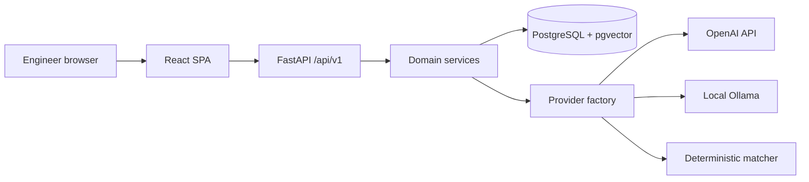

# Architecture

VAVE Intelligence is a single-page React application and a FastAPI service. PostgreSQL, with pgvector, is the system of record. The browser never calls an inference provider.

## Layers

- Presentation: React routes under `frontend/src/features`. Server state uses TanStack Query. The UI does not calculate official savings or rejection status.
- API: thin handlers in `backend/app/api/v1/router.py`.
- Services: ideas, import, duplicate detection, embeddings, copilot, analytics, evaluation, audit, and the corporate source adapter.
- Providers: `online` builds an OpenAI client, `offline` builds an Ollama client, `fallback` builds the deterministic matcher. Offline and fallback refuse to construct an OpenAI client.
- Data: SQLAlchemy models and Alembic migrations. One idea row, many vehicle-applicability rows.

## Duplicate pipeline

1. Normalise the description and keep the original text.
2. Exact match on the normalised description.
3. Fuzzy match with RapidFuzz on the comparison text.
4. Embed with the active 384-dimension model and search pgvector.
5. Deduplicate candidates by idea id.
6. Classify with the heuristic comparison. A language model, when the mode supplies one, may rerank the strongest candidates.
7. Attach historical rejection fields from the database after the model returns. The model cannot write those fields.
8. Store the run, the model names, and, later, the separate human decision.

## Knowledge copilot

Document chunks are embedded as `document_chunk` rows. Idea vectors stay in the same table with `entity_type = idea`, and retrieval filters by entity type and embedding model. Answers quote retrieved excerpts or abstain.

## Modes

| Mode | Chat | Embeddings | Outbound inference |
| --- | --- | --- | --- |
| online | OpenAI | OpenAI or another configured provider | Allowed only to the configured OpenAI base URL |
| offline | Ollama on an allow-listed host | Ollama or deterministic | OpenAI is blocked. Missing models are not downloaded |
| fallback | None | deterministic-hash-v1 | None |

Changing the embedding model does not delete old vectors. Searches filter by model name. An administrator re-index writes vectors for the active model. A dimension other than 384 needs a new migration.
