# Evaluation results: v2 hard set

Run on 26 October 2026, on Windows 11 with Python 3.14, sentence-transformers 6.2.0, PyTorch 2.14.1 (CPU), and the hosted Neon development database.

Every number here comes from `data/vave_duplicate_eval_set_v2.xlsx`, a synthetic workbook generated for this project. Read [Limitations](#limitations) before relying on any of it.

## Summary

- **Overall, precision 1.0, recall 0.322, F1 0.487.** Of 90 labelled duplicates, 29 were called Potential Duplicate. There were no false positives.
- **Recall depends almost entirely on wording.** Easy duplicates: recall 0.967 (29 of 30). Medium and hard duplicates: recall 0 (0 of 60).
- **Retrieval is not the cause.** All 90 labelled duplicates were among the 15 candidates shown, 65 of them at rank 1. Scoring end to end and scoring the classifier alone give identical precision, recall, and F1.
- **One classifier rule causes 53 of the 61 misses.** A same-component pair with word overlap (Jaccard) below 0.28 is called Similar but Distinct, even when nothing shows a different mechanism. Paraphrased duplicates have Jaccard 0.10 – 0.34. That rule has since been removed. Those 53 now go to manual review, recall is unchanged, and 127 correct look-alike verdicts went to manual review with them ([details](#after-removing-the-low-overlap-rule)).
- **The embedding separates the labels better than the verdict does,** but not cleanly. Within each query, the labelled duplicate has the highest MiniLM cosine of its labelled candidates in 83 of 90 queries. Across queries, 28 similar-but-distinct pairs score above 0.80, where 77 of the 90 duplicates sit.
- **A semantic route to Potential Duplicate** (same component, cosine ≥ threshold, no detected different action) was added on 27 October 2026, off by default. On the 15 held-out component families, a threshold of 0.82 chosen on the other 15 gives **precision 0.857, recall 0.800, F1 0.828**, against recall 0.333 and F1 0.500 without the route. At 0.91, the lowest threshold with precision 1.0 on the tuning families, held-out precision stays 1.0 but recall is only 0.378. See [Semantic Potential Duplicate route](#semantic-potential-duplicate-route).

## Setup

### Database state

- **Removed first:** the 7 earlier test submissions, VAVE-NEW-00001 to -00007, with their 7 analysis runs, 105 candidate rows, 3 vehicle rows, and 14 embedding vectors. None had a review decision. The deletion was recorded in the audit log as `idea.delete_test_submissions`. This also removed analysis `a8555c14`, which [evaluation-results.md](evaluation-results.md#observed-examples) quotes; the figures quoted there are unchanged.
- **Remaining historical ideas:** 20, VAVE-SYN-001 to -020.
- **Imported:** the Ideas sheet, 91 rows, through the normal preview → commit import (batch `d56eccdc-83cf-4bf4-893d-36d99570e269`, marked synthetic, 0 errors). The 52 warnings were all department names outside the initial catalogue (Electrical, Powertrain, Axle, and similar), which are kept as given.
- **Evaluated against:** 111 historical ideas, each with an `all-MiniLM-L6-v2` vector.

The first commit attempt returned HTTP 500 and wrote nothing. `import_commit` crashed on every commit that changed rows; see [Defect found while loading](#defect-found-while-loading).

### Pipeline

| Setting | Value |
| --- | --- |
| AI mode | offline |
| Embedding | `sentence-transformers/all-MiniLM-L6-v2` |
| Language model | Ollama not running, so every verdict comes from `classify_pair` |
| `retrieval_top_k` | 15 |
| `cosine_retrieve_threshold` | 0.40 |
| `fuzzy_strong_threshold` | 86 |

### Method

Command: `HF_HUB_OFFLINE=1 backend/.venv/bin/python scripts/evaluate_hard_set.py data/vave_duplicate_eval_set_v2.xlsx out.json`.

- **Each of the 90 TestQueries** is created as a submission with `create_submission`, using its component, department, text fields, saving, and vehicle volumes. It is then analysed with `analyze_submission` and the application's own runtime, exactly as `POST /ideas/analyze-duplicates` does. The transaction is rolled back afterwards, so no submission, run, or evaluation record is stored.
- **Each of the 597 LabelledPairs** is scored twice:
  - **End to end:** the category the pipeline gave that candidate. A candidate the pipeline did not show counts as not a duplicate.
  - **Classifier only:** `classify_pair` on the pair, whatever retrieval did.
- **Metrics** use `classification_metrics` from `evaluation_service.py`, as `scripts/evaluate.py` does. The positive class is `duplicate`, and only Potential Duplicate counts as a positive prediction. Insufficient Evidence counts as an abstention and as a negative.
- **Cosine** is computed directly between the query's vector and each candidate's stored vector, so it does not depend on the vector search limit. The query is embedded from all its fields, as in the live app.

## Precision, recall, and F1

End to end:

| Difficulty | Pairs | Duplicates | Precision | Recall | F1 | FP rate | TP | FP | FN | TN | Abstentions |
| --- | --- | --- | --- | --- | --- | --- | --- | --- | --- | --- | --- |
| **overall** | 597 | 90 | **1.000** | **0.322** | **0.487** | 0.000 | 29 | 0 | 61 | 507 | 60 |
| easy | 300 | 30 | 1.000 | 0.967 | 0.983 | 0.000 | 29 | 0 | 1 | 270 | 28 |
| medium | 30 | 30 | — | 0.000 | — | — | 0 | 0 | 30 | 0 | 6 |
| hard | 267 | 30 | — | 0.000 | — | 0.000 | 0 | 0 | 30 | 237 | 26 |

"—" means the metric is undefined: no pair at that difficulty was predicted a duplicate, and the medium set has no negatives at all.

Classifier only, the precision, recall, F1, and counts are identical in every row. Only the abstentions differ (207 overall: 150 easy, 6 medium, 51 hard), because the classifier also judges the unrelated pairs that retrieval never showed.

**Difficulty is tied to the label in this workbook,** so the per-difficulty rows are not like-for-like:

| Label | easy | medium | hard |
| --- | --- | --- | --- |
| duplicate | 30 | 30 | 30 |
| similar but distinct | 0 | 0 | 237 |
| unrelated | 270 | 0 | 0 |

- "Easy" is easy duplicates mixed with unrelated pairs.
- "Medium" is duplicates only.
- "Hard" is hard duplicates mixed with all the similar-but-distinct pairs.

## Predicted category by label

End to end. "Not shown" means the candidate was not among the 15 shown.

| Label | Potential Duplicate | Insufficient Evidence | Similar but Distinct | Not shown | Total |
| --- | --- | --- | --- | --- | --- |
| duplicate (easy) | 29 | 1 | 0 | 0 | 30 |
| duplicate (medium) | 0 | 6 | 24 | 0 | 30 |
| duplicate (hard) | 0 | 1 | 29 | 0 | 30 |
| similar but distinct | 0 | 25 | 141 | 71 | 237 |
| unrelated | 0 | 27 | 0 | 243 | 270 |

- **Duplicates are retrieved.** All 90 were shown. Rank among the 15 shown:
  - easy: 25 at rank 1, worst rank 4
  - medium: 20 at rank 1, worst rank 9
  - hard: 20 at rank 1, worst rank 11
- **The verdict is what fails.** 53 duplicates were called Similar but Distinct, which tells a reviewer the opposite of the truth. Another 8 were sent to manual review.
- **No look-alike was called a duplicate.** Of the 237 similar-but-distinct pairs, 141 were correctly labelled, 25 went to manual review, and 71 were not shown.
- **Reviewer load:** every query showed exactly 15 candidates. The headline outcome was Potential Duplicate for 30 queries and Insufficient Evidence for the other 60.

## Score distributions by label

Fuzzy is RapidFuzz `token_set_ratio` on the comparison text. Jaccard is the word overlap that `classify_pair` uses. Cosine is MiniLM.

### Cosine

| Label | Difficulty | n | min | p25 | median | p75 | max | mean |
| --- | --- | --- | --- | --- | --- | --- | --- | --- |
| duplicate | all | 90 | 0.691 | 0.830 | 0.875 | 0.957 | 0.989 | 0.881 |
| duplicate | easy | 30 | 0.870 | 0.957 | 0.968 | 0.975 | 0.989 | 0.961 |
| duplicate | medium | 30 | 0.702 | 0.824 | 0.859 | 0.906 | 0.951 | 0.857 |
| duplicate | hard | 30 | 0.691 | 0.790 | 0.833 | 0.870 | 0.923 | 0.827 |
| similar but distinct | hard | 237 | 0.375 | 0.631 | 0.715 | 0.760 | 0.910 | 0.684 |
| unrelated | easy | 270 | 0.172 | 0.392 | 0.443 | 0.502 | 0.696 | 0.446 |

### Fuzzy

| Label | Difficulty | n | min | p25 | median | p75 | max | mean |
| --- | --- | --- | --- | --- | --- | --- | --- | --- |
| duplicate | all | 90 | 56.2 | 62.2 | 67.0 | 87.0 | 98.5 | 72.3 |
| duplicate | easy | 30 | 80.0 | 86.5 | 88.7 | 91.3 | 98.5 | 88.5 |
| duplicate | medium | 30 | 57.9 | 61.5 | 65.1 | 68.2 | 77.0 | 65.2 |
| duplicate | hard | 30 | 56.2 | 59.2 | 62.5 | 65.8 | 73.3 | 63.1 |
| similar but distinct | hard | 237 | 43.2 | 53.4 | 55.9 | 58.8 | 80.6 | 56.2 |
| unrelated | easy | 270 | 39.8 | 46.0 | 48.8 | 51.9 | 65.2 | 49.2 |

### Jaccard

| Label | Difficulty | n | min | p25 | median | p75 | max | mean |
| --- | --- | --- | --- | --- | --- | --- | --- | --- |
| duplicate | all | 90 | 0.103 | 0.174 | 0.237 | 0.515 | 0.786 | 0.331 |
| duplicate | easy | 30 | 0.455 | 0.515 | 0.583 | 0.646 | 0.786 | 0.583 |
| duplicate | medium | 30 | 0.116 | 0.168 | 0.224 | 0.267 | 0.344 | 0.221 |
| duplicate | hard | 30 | 0.103 | 0.158 | 0.179 | 0.225 | 0.300 | 0.189 |
| similar but distinct | hard | 237 | 0.021 | 0.085 | 0.122 | 0.162 | 0.394 | 0.130 |
| unrelated | easy | 270 | 0.018 | 0.049 | 0.073 | 0.111 | 0.282 | 0.085 |

What the distributions show:

- **No easy duplicate falls below 0.87 cosine or 80 fuzzy.** That is why the lexical rules catch them.
- **Medium and hard duplicates look lexically like look-alikes.** No medium or hard duplicate reaches fuzzy 86 or Jaccard 0.62, the two rules that call a duplicate without other conditions. Their fuzzy range of 56 – 77 overlaps the similar-but-distinct range of 43 – 81.
- **Cosine keeps more of the gap.** The medium and hard duplicate medians, 0.859 and 0.833, are well above the similar-but-distinct median of 0.715. The ranges still overlap, though: similar-but-distinct pairs reach 0.910, and 28 of them are at 0.80 or above, alongside 77 of the 90 duplicates. No single cosine threshold separates the two labels.
- **Unrelated pairs are well separated on every score.** Their maxima are cosine 0.696 and fuzzy 65.2. Retrieval hid 243 of the 270.
- **Within a query, ranking works.** The labelled duplicate has the highest cosine among that query's labelled candidates in 83 of 90 queries: 30 of 30 easy, 28 of 30 medium, 25 of 30 hard. It has the highest fuzzy score in 82.

## Why medium and hard duplicates are missed

Each of the 61 missed duplicates was traced through the branches of `classify_pair`:

| Difficulty | Verdict | Branch | Pairs |
| --- | --- | --- | --- |
| medium | Similar but Distinct | same component, Jaccard < 0.28 | 24 |
| hard | Similar but Distinct | same component, Jaccard < 0.28 | 29 |
| medium | Insufficient Evidence | same component, Jaccard 0.28 – 0.45 | 6 |
| hard | Insufficient Evidence | same component, Jaccard 0.28 – 0.45 | 1 |
| easy | Insufficient Evidence | fell through every rule | 1 |

**The main cause was this rule** in `classifier.py` (since removed, see [below](#after-removing-the-low-overlap-rule)):

```python
elif same_component and overlap < 0.45:
    category = "similar_but_distinct" if different_mechanism or overlap < 0.28 else "insufficient_evidence"
```

- **What it does:** for a same-component pair, Jaccard below 0.28 alone is enough to return Similar but Distinct, whether or not the detected kinds of change differ.
- **Why that fails here:** a paraphrase that keeps the meaning and changes the words lands in exactly this branch.
- **Mechanism detection did not help.** On the 61 misses, `change_types()` found no kind of change in either text for 17 pairs, and found one only in the historical text for 31 more. It found one in both texts for only 13. Its keyword lists do not match paraphrases.

Hard examples (all labelled duplicate, all called Similar but Distinct):

| Query → candidate | Fuzzy | Jaccard | Cosine | Query wording | Historical wording |
| --- | --- | --- | --- | --- | --- |
| Q-0003 → H-0001 | 58.1 | 0.188 | 0.835 | "move away from the current ferrous part to a light-alloy design, geometry adjusted so rigidity is not lost" | "Replace the steel cab mounting bracket with an aluminium alloy bracket sized for equivalent stiffness" |
| Q-0006 → H-0005 | 59.5 | 0.167 | 0.827 | "drop the coated metal pressing in favour of a thermoplastic moulding" | "Change the low-voltage battery tray from painted steel to a formed polypropylene tray" |
| Q-0009 → H-0008 | 61.3 | 0.143 | 0.760 | "Thinner sump wall, with an internal plate added so oil movement … does not uncover the pickup" | "Reduce engine oil pan sheet thickness from 1.5 mm to 1.2 mm and add a baffle" |
| Q-0012 → H-0011 | 68.4 | 0.238 | 0.874 | "One mirror mount for both sides instead of two mirror-image parts" | "Commonise the left and right exterior mirror brackets into one handed bracket" |

In each case a reviewer would be told the historical idea is a different change.

**This is the risk noted in [evaluation-results.md](evaluation-results.md#2-a-high-cosine-look-alike-was-correctly-separated-by-keywords): "A paraphrase that avoids those keywords would lose this protection."** On this set the failure goes further than losing protection, because the low-overlap rule returns the opposite verdict.

### After removing the low-overlap rule

The rule was changed so that this branch returns Insufficient Evidence. Similar but Distinct now needs a detected difference in technical action. That case is handled one branch earlier, which already covered every same-component pair with disjoint kinds of change, so the `different_mechanism` part of the old line could never be true. The live condition was `overlap < 0.28` alone.

The evaluation was re-run on the same data and settings. Recall cannot change, because these pairs fail every rule that leads to Potential Duplicate:

| Difficulty | Recall before | Recall after | Precision before → after | F1 before → after | Abstentions before → after |
| --- | --- | --- | --- | --- | --- |
| overall | 0.322 | 0.322 | 1.000 → 1.000 | 0.487 → 0.487 | 60 → 240 |
| easy | 0.967 | 0.967 | 1.000 → 1.000 | 0.983 → 0.983 | 28 → 28 |
| medium | 0.000 | 0.000 | — → — | — → — | 6 → 30 |
| hard | 0.000 | 0.000 | — → — | — → — | 26 → 182 |

What changed was the verdict on 180 pairs, end to end:

| Label | Potential Duplicate | Insufficient Evidence | Similar but Distinct | Not shown |
| --- | --- | --- | --- | --- |
| duplicate (easy) | 29 → 29 | 1 → 1 | 0 → 0 | 0 → 0 |
| duplicate (medium) | 0 → 0 | 6 → **30** | 24 → **0** | 0 → 0 |
| duplicate (hard) | 0 → 0 | 1 → **30** | 29 → **0** | 0 → 0 |
| similar but distinct | 0 → 0 | 25 → **152** | 141 → **14** | 71 → 71 |
| unrelated | 0 → 0 | 27 → 27 | 0 → 0 | 243 → 243 |

- **Gained:** no duplicate is now called Similar but Distinct. The 53 that were now go to manual review.
- **Lost:** 127 correct Similar but Distinct verdicts on look-alikes also went to manual review. Only 14 of the 237 look-alikes are still called distinct, because only those have a detected difference in action.
  - Most of the old rule's correct verdicts rested on low word overlap, which is the same signal that mislabelled the paraphrased duplicates.
  - On this set, low overlap was weak evidence either way: 53 times it pointed the wrong way, and 127 times the right way.
- **Reviewer load:**
  - Per candidate, labelled pairs sent to manual review went from 60 to 240.
  - Per query, the headline outcome is unchanged (30 Potential Duplicate, 60 Insufficient Evidence), because Insufficient Evidence already outranked Similar but Distinct in every affected query.
- **The v1 evaluation is unaffected by construction.** `scripts/evaluate.py` passes `query_component=None`, so the same-component branch is never reached there.

Raising medium and hard recall needs a positive signal that the action is the same, despite different words. The candidates are a language model comparison, wider `change_types()` vocabulary, or embedding similarity. Removing this rule does not provide one.

## Other observations

- **An unlabelled duplicate in the seed data.** Query Q-0037 ("Change the disc brake pad to a cheaper friction material and add an edge chamfer …"):
  - It was flagged Potential Duplicate against **VAVE-SYN-002** (fuzzy 87.2, cosine 0.938). That is the seeded brake-pad chamfer idea, which describes the same change.
  - The workbook does not label it, because the workbook only knows its own VAVE-H ideas, so the hit does not count in the metrics.
  - Its labelled duplicate, VAVE-H-0038 (fuzzy 80.0, cosine 0.970, the highest cosine of any candidate), went to manual review. That pair is the 1 easy miss.
- **The cosine threshold did not matter.** The candidate filter is `exact OR fuzzy ≥ 40 OR cosine ≥ 0.40`. Every duplicate has fuzzy ≥ 56, so all would be shown at any threshold.
- **Comparison with the v1 set.** The 12-case v1 set ([evaluation-results.md](evaluation-results.md)) gave recall 0.8, and its 5 duplicates all had fuzzy ≥ 86. It measured the easy case only. The v2 easy row, recall 0.967, agrees with it.

## Defect found while loading

`POST /api/v1/ideas/import/commit` returned HTTP 500 on every commit that inserted or updated rows. The import transaction rolled back, so nothing was written.

- **Cause:** two lines in `import_commit` (`app/api/v1/router.py`).
  - One read `row.idea_id` from the result of `db.scalars(select(ImportChange.idea_id))`, which already returns plain ids.
  - The other built a list of `DuplicateAnalysisCandidate.idea_id`, an attribute that does not exist, before discarding the list with `and []`. It crashed whenever any analysis candidate existed.
- **Why the tests missed it:** the only import test commits a preview with errors and expects 400.
- **Fix:** read the ids directly, and remove the dead line.
- **Test:** `test_valid_import_commits_and_indexes` commits a one-row CSV and checks that the idea is inserted and embedded. It fails without the fix.

**Still open: import rollback fails for inserted rows.** `import_changes.idea_id` is `NOT NULL` with no `ON DELETE` rule, so deleting an inserted idea is refused with a foreign-key violation. A fix needs a schema decision:
- make the column nullable with `ON DELETE SET NULL`, which keeps the change history, or
- delete those change rows.

Rollback also leaves the idea's embedding vectors behind.

## Semantic Potential Duplicate route

Run on 27 October 2026, same database, data, and settings as above.

### The rule

`classify_pair` (`duplicate_detection/classifier.py`) has a second route to Potential Duplicate, checked after the lexical one. It fires when all of these hold:

- **The component matches** (normalised component names are equal).
- **Cosine ≥ `semantic_duplicate_threshold`.** In the app this is the vector-search score that `rank_historical` passes in.
- **No positive evidence of a different action:** `change_types()` did not detect disjoint kinds of change in the two texts. If either text has no detected change, nothing blocks the route.

The route is **off by default**:
- `semantic_duplicate_threshold` is `None` in `config.py` and in the stored AI settings, so the live app and every existing test behave exactly as before.
- An administrator can set it with `PUT /api/v1/ai/settings`, and an explicit `null` turns it off again. It is not on the AI settings page yet.

A verdict reached this way says so in its explanation, including the cosine and the threshold.

### Method

- **Command:**
  ```bash
  HF_HUB_OFFLINE=1 backend/.venv/bin/python scripts/evaluate_hard_set.py data/vave_duplicate_eval_set_v2.xlsx out.json --sweep 0.70 0.95 0.01 --split-families 15
  ```
- **One pipeline run, then a replay.** The pipeline runs once per query with the route off. `classify_pair` is then re-run for every labelled pair at each threshold, from 0.70 to 0.95 in steps of 0.01. Which candidates are shown does not depend on the verdict, so the shown set is the same at every threshold.
  - **End to end** uses the cosine the pipeline saw.
  - **Classifier only** uses the directly computed cosine. The two agree to within 3 × 10⁻⁷ wherever both exist.
- **Metrics:** end to end, as in the tables above. A pair the pipeline did not show counts as not a duplicate.
- **Cross-check.** The full pipeline was also run with `--semantic-threshold 0.82`, so the route ran inside `analyze_submission` itself. It gave exactly the replayed result:
  - end to end: TP 73, FP 10, FN 17, TN 497
  - classifier only: TP 73, FP 12, FN 17, TN 495
- **Coverage.** All 90 labelled duplicates are same-component pairs, and all have a pipeline cosine, so every one can reach the route.
  - 41 shown negative pairs have no pipeline cosine, because they fell outside the top-20 vector search.
  - Their direct cosines are at most 0.614, below the sweep range, so the missing score changes nothing here.
- **Connection drops.** The hosted database dropped the connection 3 times in the sweep run, once in the cross-check run and once in the split run. Each query runs in a rolled-back transaction, so the script retries it on a new session. Every retry succeeded on its first attempt.

### Sweep on all 30 families



All 597 pairs, end to end. The route is off at baseline: precision 1.000, recall 0.322, F1 0.487. Each threshold picked in this table is chosen and scored on the same data, so it is optimistic. The [held-out split](#held-out-split-by-component-family) below is the fair measure.

| Threshold | Precision | Recall | F1 | TP | FP | FN | Recall easy | Recall medium | Recall hard |
| --- | --- | --- | --- | --- | --- | --- | --- | --- | --- |
| 0.70 | 0.486 | 0.989 | 0.652 | 89 | 94 | 1 | 1.000 | 1.000 | 0.967 |
| 0.71 | 0.503 | 0.978 | 0.664 | 88 | 87 | 2 | 1.000 | 0.967 | 0.967 |
| 0.72 | 0.527 | 0.978 | 0.685 | 88 | 79 | 2 | 1.000 | 0.967 | 0.967 |
| 0.73 | 0.561 | 0.978 | 0.713 | 88 | 69 | 2 | 1.000 | 0.967 | 0.967 |
| 0.74 | 0.596 | 0.967 | 0.737 | 87 | 59 | 3 | 1.000 | 0.933 | 0.967 |
| 0.75 | 0.639 | 0.944 | 0.762 | 85 | 48 | 5 | 1.000 | 0.900 | 0.933 |
| 0.76 | 0.664 | 0.922 | 0.772 | 83 | 42 | 7 | 1.000 | 0.900 | 0.867 |
| 0.77 | 0.692 | 0.900 | 0.783 | 81 | 36 | 9 | 1.000 | 0.900 | 0.800 |
| 0.78 | 0.727 | 0.889 | 0.800 | 80 | 30 | 10 | 1.000 | 0.867 | 0.800 |
| 0.79 | 0.765 | 0.867 | 0.812 | 78 | 24 | 12 | 1.000 | 0.833 | 0.767 |
| 0.80 | 0.811 | 0.856 | 0.832 | 77 | 18 | 13 | 1.000 | 0.833 | 0.733 |
| 0.81 | 0.828 | 0.856 | 0.842 | 77 | 16 | 13 | 1.000 | 0.833 | 0.733 |
| **0.82** | 0.880 | 0.811 | 0.844 | 73 | 10 | 17 | 1.000 | 0.800 | 0.633 |
| 0.83 | 0.932 | 0.756 | 0.834 | 68 | 5 | 22 | 1.000 | 0.733 | 0.533 |
| 0.84 | 0.940 | 0.700 | 0.803 | 63 | 4 | 27 | 1.000 | 0.700 | 0.400 |
| 0.85 | 0.952 | 0.656 | 0.776 | 59 | 3 | 31 | 1.000 | 0.633 | 0.333 |
| 0.86 | 0.947 | 0.600 | 0.735 | 54 | 3 | 36 | 1.000 | 0.467 | 0.333 |
| 0.87 | 0.944 | 0.567 | 0.708 | 51 | 3 | 39 | 1.000 | 0.467 | 0.233 |
| 0.88 | 0.938 | 0.500 | 0.652 | 45 | 3 | 45 | 1.000 | 0.400 | 0.100 |
| 0.89 | 0.955 | 0.467 | 0.627 | 42 | 2 | 48 | 1.000 | 0.367 | 0.033 |
| 0.90 | 0.976 | 0.456 | 0.621 | 41 | 1 | 49 | 1.000 | 0.333 | 0.033 |
| **0.91** | 1.000 | 0.389 | 0.560 | 35 | 0 | 55 | 1.000 | 0.133 | 0.033 |
| 0.92 | 1.000 | 0.367 | 0.537 | 33 | 0 | 57 | 1.000 | 0.067 | 0.033 |
| 0.93 | 1.000 | 0.356 | 0.525 | 32 | 0 | 58 | 1.000 | 0.067 | 0.000 |
| 0.94 | 1.000 | 0.356 | 0.525 | 32 | 0 | 58 | 1.000 | 0.067 | 0.000 |
| 0.95 | 1.000 | 0.344 | 0.512 | 31 | 0 | 59 | 1.000 | 0.033 | 0.000 |

On all 597 pairs:

- **Highest F1: 0.82**, F1 0.844. 10 similar-but-distinct pairs are called Potential Duplicate.
- **Lowest threshold with precision 1.0: 0.91.** Recall 0.389, F1 0.560. Precision stays 1.0 at every higher threshold.
- **Every false positive is a same-component look-alike.** No unrelated pair is ever called a duplicate, because unrelated pairs never share the component.
- **The keyword check still does part of the work.** At 0.82, 16 same-component look-alikes reach the threshold:
  - 4 are blocked by a detected different action
  - 2 are not shown
  - 10 become false positives

Classifier only, the numbers match end to end from 0.84 upwards. Below that, classifier only has more false positives, because it also judges look-alikes that retrieval never showed.

### Held-out split by component family

**Families.** A family is the query component. Each of the 30 components has exactly 3 TestQueries, easy, medium and hard, which reword the same idea. A split by query would put rewordings of one idea on both sides, so the split is by family, in the order families first appear in TestQueries:

- **Tuning:** families 1 – 15, queries VAVE-Q-0001 – 0045. Cab mounting bracket, Battery tray, Engine oil pan, Exterior mirror bracket, Frame intermediate crossmember, Cab wiring harness, Tail lamp lens, Rear axle banjo housing, Air intake duct, Steering column lower bracket, Propeller shaft tube, Headliner substrate, Disc brake pad, Fuel tank mounting strap, Radiator mounting bracket. 301 pairs, 45 duplicates.
- **Held out:** families 16 – 30, queries VAVE-Q-0046 – 0090. Cab door inner panel, Suspension bump stop, Instrument panel bracket, Exhaust heat shield, Air tank mounting bracket, Seat frame rail, Front fender bracket, Washer fluid reservoir, Alternator mounting bracket, Spring hanger bracket, Front grille mesh, Clutch pedal assembly, Fuel filter head, Cab step assembly, Gear shift lever knob. 296 pairs, 45 duplicates.

**Leakage through other pairs.** A pair belongs to its query's family. A tuning query's unrelated pairs point at ideas from other families, but the route needs the same component, so those pairs can never fire it.

**Selection rule, fixed before any held-out number was read:**
- Use the threshold with the highest F1 on the tuning families, breaking ties toward the higher threshold.
- Also report the lowest threshold with precision 1.0 on the tuning families.

The held-out numbers were only read off at those two thresholds.

**Chosen thresholds:** **0.82** (highest tuning F1) and **0.91** (lowest tuning threshold with precision 1.0). Both are the same as on all 30 families.

#### Tuning set and held-out set, side by side

| Threshold | Set | Precision | Recall | F1 | TP | FP | FN | Recall easy | Recall medium | Recall hard |
| --- | --- | --- | --- | --- | --- | --- | --- | --- | --- | --- |
| route off | Tuning | 1.000 | 0.311 | 0.475 | 14 | 0 | 31 | 0.933 | 0.000 | 0.000 |
| route off | **Held-out** | **1.000** | **0.333** | **0.500** | 15 | 0 | 30 | 1.000 | 0.000 | 0.000 |
| **0.82** (max tuning F1) | Tuning | 0.902 | 0.822 | 0.860 | 37 | 4 | 8 | 1.000 | 0.867 | 0.600 |
| **0.82** (max tuning F1) | **Held-out** | **0.857** | **0.800** | **0.828** | 36 | 6 | 9 | 1.000 | 0.733 | 0.667 |
| **0.91** (precision 1.0 on tuning) | Tuning | 1.000 | 0.400 | 0.571 | 18 | 0 | 27 | 1.000 | 0.200 | 0.000 |
| **0.91** (precision 1.0 on tuning) | **Held-out** | **1.000** | **0.378** | **0.548** | 17 | 0 | 28 | 1.000 | 0.067 | 0.067 |

Each difficulty has 15 held-out duplicates, so one pair moves a per-difficulty recall by 0.067.

**The tuning-to-held-out gap:**

| Threshold | Precision | Recall | F1 |
| --- | --- | --- | --- |
| 0.82 | −0.045 (0.902 → 0.857) | −0.022 (0.822 → 0.800) | −0.032 (0.860 → 0.828) |
| 0.91 | 0.000 (1.000 → 1.000) | −0.022 (0.400 → 0.378) | −0.023 (0.571 → 0.548) |

What the split shows:

- **At 0.82 the route generalises with a small loss.**
  - Held-out F1 is 0.828, against 0.860 on the tuning families. Without the route it is 0.500.
  - Held-out recall more than doubles, from 0.333 to 0.800, and the gain is entirely medium and hard duplicates.
  - The cost is 6 held-out look-alikes called Potential Duplicate, against none without the route.
- **0.91 buys precision with almost no recall.** Held-out precision stays 1.0, but recall is 0.378, only 2 duplicates more than the route-off 0.333. Medium and hard recall is 0.067 each, which is one pair.
- **Precision 1.0 is set by one tuning pair, not by the data as a whole.**
  - The highest-cosine same-component look-alike in the tuning families scores 0.910, which pushes the tuning precision-1.0 threshold up to 0.91.
  - In the held-out families the highest scores 0.838. Held-out precision is already 1.0 from 0.84, at recall 0.733.
  - A threshold aimed at "no false positives" is therefore decided by the single worst look-alike in the tuning data, and will not carry over to other data.
- **Held-out F1 would peak at 0.83 (0.850), not 0.82.** This is reported only to show how flat the top of the curve is. Choosing 0.83 because of it would be tuning on the held-out set.

#### Full split sweep

End to end. FP is the number of look-alikes called Potential Duplicate.

| Threshold | Tuning P | Tuning R | Tuning F1 | Tuning FP | Held-out P | Held-out R | Held-out F1 | Held-out FP |
| --- | --- | --- | --- | --- | --- | --- | --- | --- |
| 0.70 | 0.484 | 0.978 | 0.647 | 47 | 0.489 | 1.000 | 0.657 | 47 |
| 0.71 | 0.506 | 0.956 | 0.662 | 42 | 0.500 | 1.000 | 0.667 | 45 |
| 0.72 | 0.524 | 0.956 | 0.677 | 39 | 0.529 | 1.000 | 0.692 | 40 |
| 0.73 | 0.558 | 0.956 | 0.705 | 34 | 0.562 | 1.000 | 0.720 | 35 |
| 0.74 | 0.600 | 0.933 | 0.730 | 28 | 0.592 | 1.000 | 0.744 | 31 |
| 0.75 | 0.656 | 0.933 | 0.771 | 22 | 0.623 | 0.956 | 0.754 | 26 |
| 0.76 | 0.702 | 0.889 | 0.784 | 17 | 0.632 | 0.956 | 0.761 | 25 |
| 0.77 | 0.736 | 0.867 | 0.796 | 14 | 0.656 | 0.933 | 0.771 | 22 |
| 0.78 | 0.780 | 0.867 | 0.821 | 11 | 0.683 | 0.911 | 0.781 | 19 |
| 0.79 | 0.812 | 0.867 | 0.839 | 9 | 0.722 | 0.867 | 0.788 | 15 |
| 0.80 | 0.844 | 0.844 | 0.844 | 7 | 0.780 | 0.867 | 0.821 | 11 |
| 0.81 | 0.864 | 0.844 | 0.854 | 6 | 0.796 | 0.867 | 0.830 | 10 |
| **0.82** | 0.902 | 0.822 | 0.860 | 4 | 0.857 | 0.800 | 0.828 | 6 |
| 0.83 | 0.895 | 0.756 | 0.819 | 4 | 0.971 | 0.756 | 0.850 | 1 |
| 0.84 | 0.882 | 0.667 | 0.759 | 4 | 1.000 | 0.733 | 0.846 | 0 |
| 0.85 | 0.903 | 0.622 | 0.737 | 3 | 1.000 | 0.689 | 0.816 | 0 |
| 0.86 | 0.893 | 0.556 | 0.685 | 3 | 1.000 | 0.644 | 0.784 | 0 |
| 0.87 | 0.889 | 0.533 | 0.667 | 3 | 1.000 | 0.600 | 0.750 | 0 |
| 0.88 | 0.880 | 0.489 | 0.629 | 3 | 1.000 | 0.511 | 0.676 | 0 |
| 0.89 | 0.917 | 0.489 | 0.638 | 2 | 1.000 | 0.444 | 0.615 | 0 |
| 0.90 | 0.955 | 0.467 | 0.627 | 1 | 1.000 | 0.444 | 0.615 | 0 |
| **0.91** | 1.000 | 0.400 | 0.571 | 0 | 1.000 | 0.378 | 0.548 | 0 |
| 0.92 | 1.000 | 0.378 | 0.548 | 0 | 1.000 | 0.356 | 0.525 | 0 |
| 0.93 | 1.000 | 0.378 | 0.548 | 0 | 1.000 | 0.333 | 0.500 | 0 |
| 0.94 | 1.000 | 0.378 | 0.548 | 0 | 1.000 | 0.333 | 0.500 | 0 |
| 0.95 | 1.000 | 0.356 | 0.525 | 0 | 1.000 | 0.333 | 0.500 | 0 |

### Data issue found in the workbook

Three query–candidate pairs appear twice in LabelledPairs, each time with conflicting labels (unrelated/easy and similar-but-distinct/hard):

- VAVE-Q-0052 → VAVE-H-0071
- VAVE-Q-0064 → VAVE-H-0001
- VAVE-Q-0079 → VAVE-H-0011

All three are in the held-out families, and none is a same-component pair. They count as negatives under either label and can never fire the route, so the figures above are unaffected. The total is 597 rows, but only 594 distinct pairs.

## Limitations

- **Synthetic, from one generator.** The 91 ideas, 90 queries, and 597 labels come from one generated workbook, and the labels encode its author's view of what counts as a duplicate. None of this is a production accuracy claim.
- **Difficulty is tied to the label** (see the table above), so the per-difficulty rows mix different negatives, and precision is undefined for medium and hard.
- **20 VAVE-SYN ideas were also present and are unlabelled.** They can be shown as candidates and take slots among the 15, but they never count in the metrics. One of them was a genuine duplicate of Q-0037.
- **No language model was involved.** With Ollama running, `analyze_submission` asks the model about up to 5 candidates per query. Where the model and the heuristic disagree on a non-exact match, the result becomes Insufficient Evidence. That could turn some of the 53 wrong Similar but Distinct verdicts into manual reviews, but it cannot produce a Potential Duplicate that the heuristic rejects. This was not measured.
- **Nothing was stored as an evaluation run.** The script is read-only, so this run does not appear on the Evaluation page.
- **One split, and a small held-out set.** The held-out set is 15 families, 45 duplicates, and 251 negatives.
  - Its false positives at 0.82 number 6, so one look-alike more or fewer moves held-out precision by about 0.02.
  - The split is the first 15 families against the last 15, in workbook order. It was not repeated with other partitions, so the size of the gap is one draw.
- **Held-out families come from the same generator,** with the same phrasing habits. They are unseen components, not unseen writing, so the held-out numbers are still likely to be better than real submissions written by different engineers.
- **Every look-alike false positive needs the same component,** and so does every duplicate here. A real history with inconsistent component names, such as "Cab mount bracket" against "Cab mounting bracket", would block the route for true duplicates. The route compares normalised names exactly.
